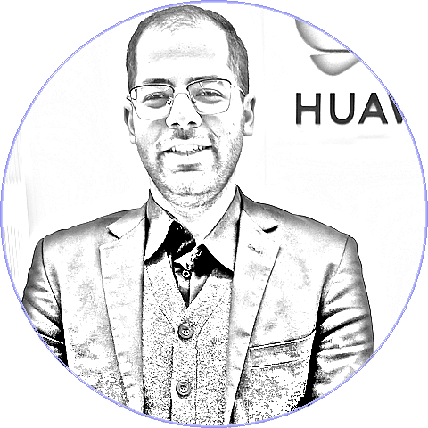
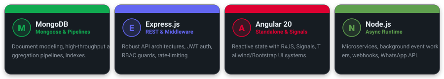
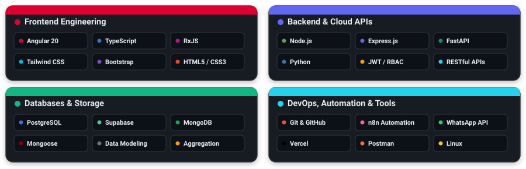
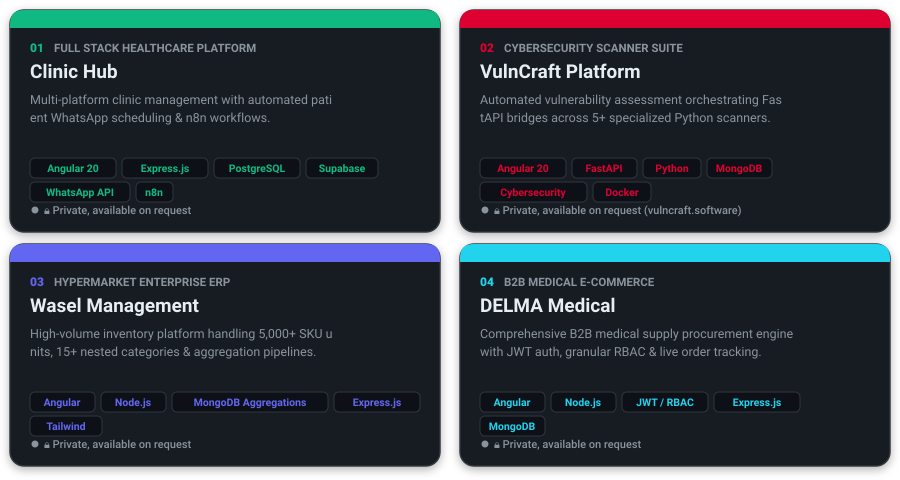
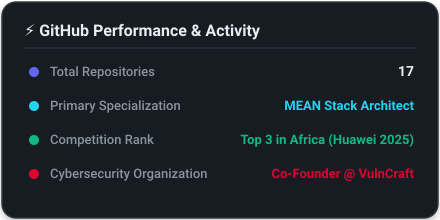
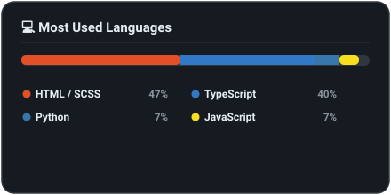
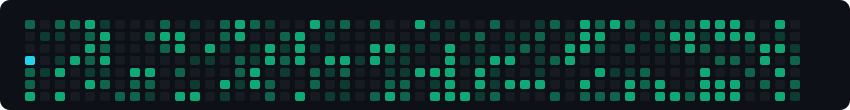
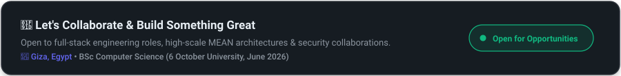

  <picture>
    <source media="(prefers-color-scheme: dark)" srcset="assets/hero-dark.svg">
    <source media="(prefers-color-scheme: light)" srcset="assets/hero-light.svg">
    
  </picture>

<!-- Profile Intro & Avatar -->
<table width="100%">
  <tr>
    <td width="140" align="center" valign="middle">
      
    </td>
    <td valign="middle">
      <h3>👋 Hi there, I'm Mohamed Fares</h3>
      

        I am a <strong>Full Stack Developer</strong> specializing in the <strong>MEAN Stack</strong> (MongoDB, Express.js, Angular 20, Node.js) based in <strong>Giza, Egypt</strong>. Passionate about building resilient web architectures, scalable enterprise ERP solutions, and developer tooling.
      

      

        Co-Founder at <a href="https://vulncraft.software"><strong>VulnCraft</strong></a>, an early-stage cybersecurity organization — awarded <strong>3rd Place in Africa</strong> at the 2025 Huawei ICT Competition. 
        BSc in Computer Science candidate at <strong>6 October University</strong> (graduating June 2026) and completed intensive MEAN Stack training at the <strong>National Telecommunication Institute (NTI)</strong>.
      

    </td>
  </tr>
</table>

<!-- Key Achievement Card -->

  <picture>
    <source media="(prefers-color-scheme: dark)" srcset="assets/achievement-dark.svg">
    <source media="(prefers-color-scheme: light)" srcset="assets/achievement-light.svg">
    
  </picture>

## ⚡ Core Specialization: MEAN Stack Architecture

  <picture>
    <source media="(prefers-color-scheme: dark)" srcset="assets/mean-stack-dark.svg">
    <source media="(prefers-color-scheme: light)" srcset="assets/mean-stack-light.svg">
    
  </picture>

## 🛠️ Technical Stack & Tooling

  <picture>
    <source media="(prefers-color-scheme: dark)" srcset="assets/tech-stack-dark.svg">
    <source media="(prefers-color-scheme: light)" srcset="assets/tech-stack-light.svg">
    
  </picture>

## 🚀 Featured Projects

  <picture>
    <source media="(prefers-color-scheme: dark)" srcset="assets/projects-dark.svg">
    <source media="(prefers-color-scheme: light)" srcset="assets/projects-light.svg">
    
  </picture>

### 📌 Project Breakdown
- **Clinic Hub** — Multi-platform clinic management platform integrating automated patient appointment scheduling via WhatsApp Business API and automated n8n workflows.
  - **Stack:** Angular 20, Express.js, PostgreSQL, Supabase, WhatsApp Business API, n8n
  - **Status:** *Private, available on request*
- **VulnCraft Platform** — Automated vulnerability assessment platform orchestrating a FastAPI bridge across 5+ specialized Python scanners.
  - **Stack:** Angular 20, FastAPI, Python, MongoDB, Docker
  - **Live Website:** [vulncraft.software](https://vulncraft.software) &nbsp;|&nbsp; **Repository:** *Private, available on request*
- **Wasel Management** — Hypermarket enterprise inventory system handling 5,000+ SKU units, 15+ nested categories, and high-performance MongoDB aggregation pipelines.
  - **Stack:** Angular, Node.js, Express.js, MongoDB Aggregation Pipelines, Tailwind CSS
  - **Status:** *Private, available on request*
- **DELMA Medical** — Comprehensive B2B medical supply procurement engine featuring JWT authentication, granular RBAC, and real-time order tracking.
  - **Stack:** Angular, Node.js, Express.js, JWT / RBAC, MongoDB
  - **Status:** *Private, available on request*

## 📈 Activity & Performance Metrics
<table width="100%">
  <tr>
    <td width="50%" align="center" valign="top">
      <picture>
        <source media="(prefers-color-scheme: dark)" srcset="assets/stats-dark.svg">
        <source media="(prefers-color-scheme: light)" srcset="assets/stats-light.svg">
        
      </picture>
    </td>
    <td width="50%" align="center" valign="top">
      <picture>
        <source media="(prefers-color-scheme: dark)" srcset="assets/languages-dark.svg">
        <source media="(prefers-color-scheme: light)" srcset="assets/languages-light.svg">
        
      </picture>
    </td>
  </tr>
</table>

### 🐍 Contribution Activity

  <picture>
    <source media="(prefers-color-scheme: dark)" srcset="assets/github-contribution-grid-snake-dark.svg">
    <source media="(prefers-color-scheme: light)" srcset="assets/github-contribution-grid-snake.svg">
    
  </picture>

## 🔭 Currently Building & Learning
- 🏢 **Building:** Expanding **VulnCraft** scanner capabilities, automated vulnerability reporting, and enterprise CI/CD security hooks.
- ⚡ **Learning & Exploring:** Deep dive into Angular 20 Signals architecture, advanced reactive micro-frontends, and distributed Node.js workers.
- 🎓 **Education & Milestones:**
  - **BSc in Computer Science** — 6 October University (*Expected graduation: June 2026*)
  - **MEAN Stack Development Track** — National Telecommunication Institute (NTI)
  - **Huawei HCIA-AI Course** — Completed comprehensive AI and machine learning training track

## 📬 Let's Connect & Collaborate

  <picture>
    <source media="(prefers-color-scheme: dark)" srcset="assets/footer-dark.svg">
    <source media="(prefers-color-scheme: light)" srcset="assets/footer-light.svg">
    
  </picture>

  
  &nbsp;
  
  &nbsp;
  
  &nbsp;
  

